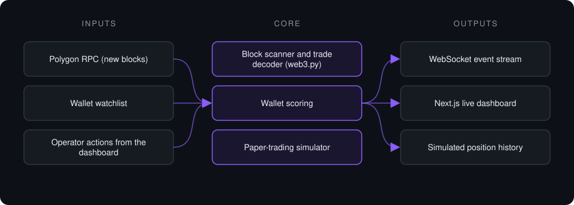

# Prediction Market Monitor

**Real-time on-chain monitoring system for prediction-market activity on Polygon, with a paper-trading simulator and a live WebSocket dashboard.**

> **This is a proprietary project. Source code is private. This page describes the system's architecture and capabilities only.**

**Case study page:** [https://jryahia.github.io/showcase-prediction-market-monitor/](https://jryahia.github.io/showcase-prediction-market-monitor/)

**Status:** Paper trading only. The system places no orders.

## Problem it solves

Prediction-market activity settles on-chain, but raw blocks are unreadable for a person watching in real time. This system reads new Polygon blocks, decodes exchange trades from a configured watchlist of wallets, scores each wallet's track record, and streams everything to a dashboard where trades can be followed or skipped in a paper-trading simulator.

## Architecture

1. The ingestion loop polls new Polygon blocks and decodes trades sent to the prediction-market exchange contracts.
2. Trades from watched wallets are normalized and each wallet's score is updated.
3. Events are pushed to every connected dashboard over a WebSocket.
4. The operator follows or skips each trade; the simulator records the outcome without touching real funds.
5. If the RPC is unreachable, the service switches to a mock feed so the dashboard keeps working.

## Key features

- On-chain trade decoding from raw blocks and receipts
- Per-wallet scoring updated on every event
- Paper-trading simulator, no live orders
- WebSocket push to any number of dashboards
- Automatic fallback feed when the RPC is down
- Kanban-style dashboard with per-trade detail

## Tech stack

      

## What it does in practice

- Turns raw on-chain activity into a readable, real-time event feed.
- Lets ideas be tested in simulation before any capital is involved.

> Not financial advice. Proprietary project, source code private.

---

Built by [Yahya Jarray](https://github.com/jryahia). Interested in a similar system? [Get in touch](mailto:yahiajarray43@gmail.com).

This repository contains no source code. It is a case study for a proprietary project. © Yahya Jarray.
